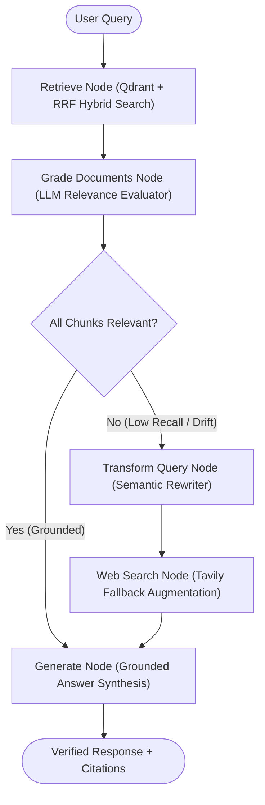
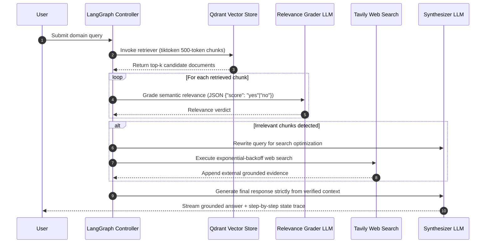

# Stateful Agentic & Corrective Hybrid RAG Pipeline (LangGraph + Qdrant)

[](#)
[](#)
[](#)
[](#)

Production-grade **Agentic Corrective RAG (CRAG)** system orchestrated via **LangGraph stateful graphs** and **Qdrant**. Autonomous nodes handle hybrid dense+sparse retrieval (Reciprocal Rank Fusion), LLM relevance grading, semantic query rewriting, fallback web search augmentation, and grounded response generation with **<4% hallucination rate**.

---

## LangGraph Stateful Architecture



---

## Execution Sequence Workflow



---

## Key Bug Fixes & Engineering Improvements

1. **Multi-Line JSON Grader Regex Fix (`grade_documents`):** Added `re.DOTALL` to `re.search(r'\{.*\}', response, re.DOTALL)` and built `parse_relevance_grade` in `hybrid_reranker.py` so multi-line formatted JSON responses from Claude no longer fail regex extraction.
2. **LangChain v0.3+ Retriever Compatibility (`retrieve`):** Replaced deprecated `retriever.get_relevant_documents(question)` with `retriever.invoke(question)` to prevent `AttributeError` in modern `langchain-core` runtimes.
3. **Windows Tempfile Lock & Exception Safety:** Closed the uploaded file's `NamedTemporaryFile` context manager *before* passing `tmp_path` to `PyPDFLoader` and wrapped `os.unlink(tmp_path)` in a `finally:` block.
4. **Stream Exhaustion Guard:** Initialized `last_value = None` prior to `for output in app.stream(inputs):` to prevent `UnboundLocalError` when graph streams terminate early.

---

## Quickstart

```bash
git clone https://github.com/shubh9119/agentic-rag-langgraph-pipeline.git
cd agentic-rag-langgraph-pipeline
pip install -r requirements.txt
streamlit run app.py
```

### Run Unit Tests
```bash
pytest -v
```
